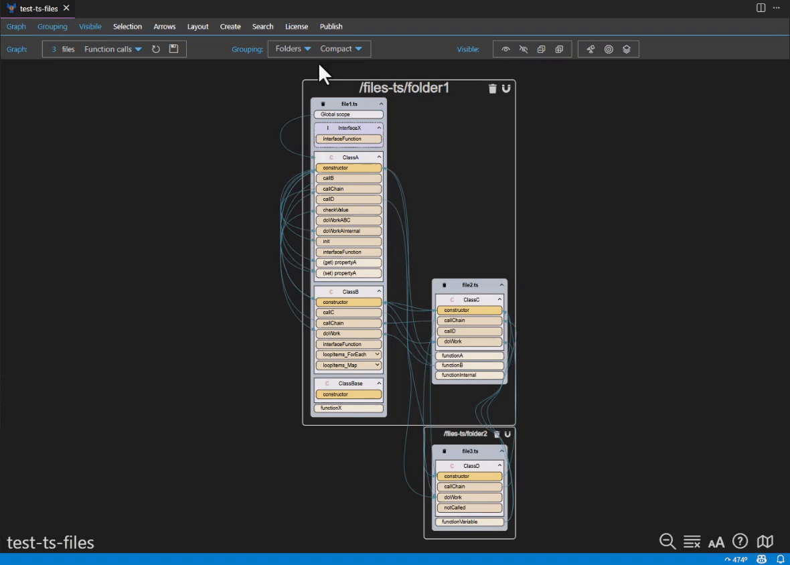

  

# Atomic Viz

<a href="https://atomicviz.web.app/">**Atomic Viz**</a> creates a visual map of your codebase, giving you a clearer understanding of its architecture, and making navigation easier.

Unlike static UML or drawing tools, Atomic Viz builds live, interactive diagrams from your real code — so the graph always reflects what your codebase actually does.

* Select a set of files to generate an interactive code diagram
* Show function call hierarchies, variable references, class inheritance, and interface implementation
* Group items by folder, file, or custom logical groups to simplify the graph
* Hide and collapse items to reduce the level of detail
* An integrated outline mirrors the graph and aids navigation
* Works with Typescript, Javascript, Python, Java, C++, Rust, and other major languages

&nbsp;
&nbsp;

&nbsp;
&nbsp;

# Features

* Interactive Code Diagrams
    * **Graph Context**: Create an interactive code diagram from selected files or folders.
    * **Call Hierarchy Visualization**: Deep-dive into a function call graph to see exactly how data flows.
    * **Dependency Tracking**: Map class inheritance, interface implementation, and follow variable references.
    * **Custom Views**: Group items by folder, file, class, or custom logical groups. Explode a class into its methods to reveal its internal call hierarchy Hide and collapse items to reduce the level of detail.
    * **Git changes**: Group 

* Code Navigation
    * **Graph To Code**: Jump directly to source code from the graph or outline.
    * **Code To Graph**: Make the graph follow the active selection in the editor.
    * **Integrated Outline**: Use a synced outline view that mirrors the graph for easy navigation.
    * **Search**: Quickly find specific nodes within complex dependency graphs.

* Language & Workspace Support
    * **Multi-Language**: Support for TypeScript, JavaScript, Python, Java, and C++, Rust, and more.
    * **VS Code Integration**: Show graphs in the sidebar, code editor, or in a detached window. Supports Light/Dark themes and graph color customization.
    * **Privacy First**: All code analysis and graph generation happens 100% locally on your machine.

* Advanced Tools
    * **Export & Share**: Save your customized graph locally as SVG or as an AtomicViz file. Publish and share the graph for team reviews.
    * **Focus Mode**: Isolate specific symbols to see immediate connections at a chosen depth.
    * **Community and Level-Of-Detail Modes**: Automatically detect functional clusters, or show only the most "connected" classes and functions within massive codebases.
    * **Multiple Graph Support**: Show multiple graphs of the same code simultaneously but customized differently to see different levels of detail

# Git Changes graph (NEW)

See exactly what changed in your Git working tree and how it ripples through the codebase — a graph built for **reviewing** changes.

Run **_AtomicViz: Create graph of Git changes_** from the Command Palette (Ctrl+Shift+P). You'll be asked a few things:

* **Which changes to compare?**
    * **Uncommitted changes**: The working tree vs the last commit (HEAD)
    * **Staged changes** : What's about to be committed
    * **Changes since a commit…**: The working tree vs a base commit you pick (for example the start of a branch), to review a whole pull request's worth of change at once
* **Which direction to trace?**
    * **Impact**: Who *calls* the changed code (what might I have broken?)
    * **Dependencies**: what the changed code *calls* (what does this change rely on?)
* **How many levels?**: How far to follow callers/callees outward from the change

If your changes span multiple languages, you'll also pick **which language to graph** — a git-changes graph shows one language at a time.

The graph then colour-codes every symbol. See the <a href="https://atomicviz.web.app/page-help">online help</a> for the colour legend and details of what the graph does and doesn't capture.

# NEW Feature (July 2026)

* New grouping mode that explodes a class into a group of its methods, so its internal call hierarchy is visible as arrows between the methods
* Explode every class at once, or explode an individual class by clicking its explode icon while leaving the others compact

# Requirements

* Install the language pack for your language

# Create a graph

You can create several types of graphs:

1. **Files**: A graph based on a set of selected files. You can show function calls, class inheritance, interface implementation, variable references, or variables that are type instances.

2. **Function**: A graph which shows the call hierarchy of single function to a selected call depth

3. **Focused symbol**: A graph which dynamically shows a graph for the function or variable selected in the editor

4. **Git changes**: A graph showing changes in your working tree and what is affected<

* To **create a graph** for **selected files**:
  > In the file explorer select the folders or files to include in the graph, right-click and choose _**AtomicViz: Create graph for selected files**_ from the context menu. Choose the command _**AtomicViz: Create graph for selected files, with variables**_ to include variable references. When multiple languages are found in the files, choose the language to graph.

* To **create a graph** for a **single function** to see its call hierarchy:
  > In the editor select a function name, right-click and choose _**AtomicViz: Create graph for selected function**_ from the context menu. You can change the call depth using the Graph toolbar.

* To **create a graph** of the **focused symbol**:
  > Open the Command Palette (Ctrl+Shift+P) and choose the command _**AtomicViz: Create graph of focused symbol**_. An empty graph will be created. Then double-click a function or variable name in the editor to select it and create the graph.

* To **create a graph** of the **Git changes**:
  > Open the Command Palette (Ctrl+Shift+P) and choose the command _**AtomicViz: Create graph of Git changes**_. Answer a few questions to configure the graph.

* NOTE: Files identified in any **.gitignore** file in the project will be ignored when creating a graph.

# Work with AtomicViz files

* To **open an Atomic Viz graph** saved to file:
  > Right-click the AtomicViz file (*.atm) in the file explorer and choose the command _**AtomicViz: Show graph**_ from the context menu.

* To **add a file** to an existing "files" graph:
  > Open the file to add to the graph in the editor. Then right-click on the Atomic Viz file in the file explorer and choose _**AtomicViz: Add active editor file to graph**_.  Alternatively, you can load or create a graph. Then right-click on a file in the file explorer and choose _**AtomicViz: Add file to graph**_. Alternatively, you can load or create a graph. Then click the button in the Graph toolbar to rebuild the graph, showing calls to outside files. The graph will include arrow icons next to functions from which such calls are made. Click an icon to choose the file to add to the graph. 

# Paid Features

* **Atomic Viz** is free with limitations on the number and size of files included in the graph, and on the call-depth when graphing a function call hierarchy. Files in excess of the limits will be shown but will be permanently collapsed.

* You can purchase an **annual license** to remove these limitations for a single machine. Create a simple graph with a few files. In the graph window show the "License" toolbar and then click the smiley face to purchase a license. When developing remotely, the license will be valid for all remote machines.

* There is currently a hard cap of the number of files allowed, for performance reasons. Contact me if you need to increase this limit.

# Documentation

* <a href="https://atomicviz.web.app/page-help">**Instructions and troubleshooting**</a>
* <a href="https://atomicviz.web.app/page-tutorial">**Video tutorials**</a>

* Graph windows
    * Choose whether to show graphs in the **AtomicViz sidebar** or in the **editor area** (Atomic Viz sidebar menu)
    * Choose whether to show graphs in **editor position** One or Two (Atomic Viz extension settings)

* Interaction with code
    * Double-click a graph item to jump to the item in code
    * Choose whether the graph follows editor selection events (Atomic Viz sidebar menu)

* Interaction with outline
    * Choose whether the editor follows outline selection (Atomic Viz outline menu)
    * Choose whether the graph follows outline selection (Atomic Viz outline menu)
    * Choose whether the outline follows editor selection (Atomic Viz outline menu)

* Pan and zoom
    * Pan the graph by clicking and dragging
    * Zoom in using the mouse wheel or a two-finger gesture on the trackpad
    * Zoom out to fit the graph in the window by right-clicking an empty area of the graph, or using the **quick toolbar** button
    * Zoom to a graph item by right-clicking on the item
    * Zoom to a group by clicking the the group's magnet icon 

* Selection
    * When nothing is selected, **all arrows** are shown.
    * When there is a selection, only the **arrows to/from** the selected items are shown. 
    * Green arrows represent incoming calls and blue arrows represent outgoing calls.
    * Click a graph item to **select or deselect** it. The children of an item are automatically selected.
    * Select **multiple graph items** by enabling multi-select in the Selection toolbar, or by holding down the shift key when selecting siblings.
    * Deselect all graph items using the space bar, or using the **quick toolbar** button. When using the spacebar to deselect everything, ensure the graph window has focus.
    * To select an item without automatically selecting its children, hold the Ctrl key when selecting the item

* Arrows
    * Click an arrow to highlight it and show a tooltip
    * Double-click an arrow to expand its source and target, or jump into the code when source and target are expanded
    * Right-click an arrow to pan the graph to its source or target

* Graph complexity
    * Remove files and folders
        * Remove a single file by clicking its trash icon
        * Remove groups of files by clicking a group's trash icon
      
    * Expand or collapse
        * Expand or collapse a graph item by clicking the **caret icon** at its top-right corner
        * Expand and collapse multiple graph items of a chosen type using the "Expand" and "Collapse" commands in the **Visible** toolbar

    * Show the hidden children of the graph item by clicking the item's **eye icon**

    * Use the hide/show commands in the **Visible** toolbar
        * Temporarily hide graph items which are selected
        * Temporarily hide graph items of a chosen type, for example interfaces or class methods called only within the class
        * Show hidden children of a graph item by clicking its eye icon
        
    * Use advanced commands in the **Visible** toolbar
        * Use Focus mode to temporarily show only the arrows for selected items, to a chosen depth
        * Use Level-of-detail mode to show only the classes and functions which are most connected, to a chosen level of detail
        * Use Community mode to see isolated communities of related classes and functions

* Quick toolbar
    * Located at bottom-right of graph window
    * Zoom out
    * Clear selection
    * Enlarge titles
    * Show documentation and tour

# Data & Privacy

* Absolutely none of your code or environment data is collected or shared
* The extension runs completely locally except to manage licensing and to send telemetry for extension usage

# How It Works

* AtomicViz uses the **language server** capabilities of VS Code that are provided for each language. The language server can provide a call hierarchy for any function, and references for any function, variable or type, so it is possible to build a map of a codebase by interrogating the language server for all the items in a given scope.

* Graphs are initially created using **Graphviz**, so the specific layout is managed by the Graphviz algorithms.

# Motivation

* Every codebase is a maze of text files that can't be naturally consumed and understood at a glance.
* A graphical representation of the code is a more immediate and commprehensive view, and more useful as a tool for understanding and navigation. 

# Feedback

I would love to hear your feedback and ideas for improvements.

* Create a disucssion on at <a href="https://github.com/briandiloreto/AtomicViz/discussions">Github discussion</a>.
* Report issues or ideas at <a href="https://github.com/briandiloreto/AtomicViz">Github Issues</a>.
* Email any questions and comments to atomicviz11@gmail.com

Thanks!

# Support Development

If you find **AtomicViz** useful, please consider supporting further development.

# License

[Copyright](LICENSE.md) &copy; Brian DiLoreto 2026
