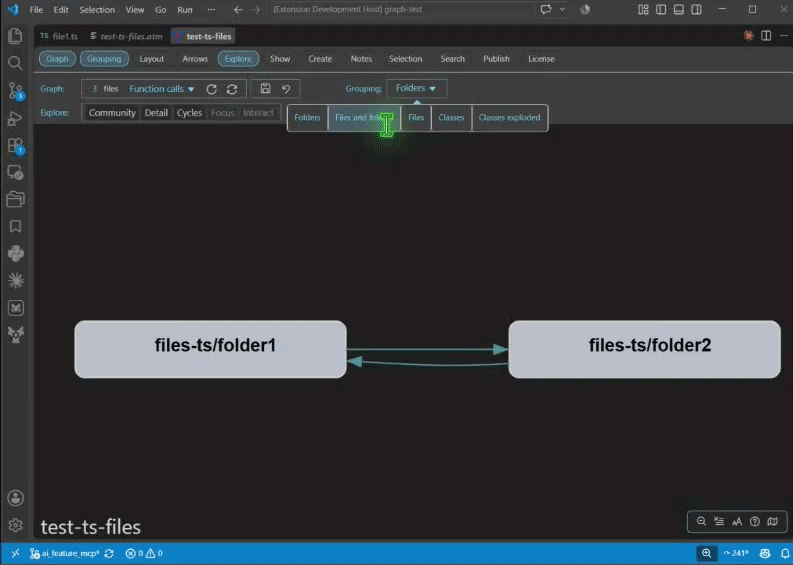

# Atomic Viz

<a href="https://atomicviz.web.app/">**Atomic Viz**</a> builds an interactive map of your codebase from the code itself, so you can understand a system's architecture at a glance and navigate it from the picture.

* **Generated from your real code**. AtomicViz reads the call hierarchy and references from VS Code's language server, so the graph always reflects what your codebase actually does.
* **Interactive**. Collapse, expand, focus, search, and double-click any item to jump into the source.
* **Made for today's pace**. Graph a subsystem in seconds, see what a Git change ripples into, or ask your AI assistant to build and annotate the graph for you.
* <a href="https://atomicviz.web.app/page-help">Documentation</a>
* <a href="https://atomicviz.web.app/page-tutorial">Video tutorials</a>

&nbsp;

&nbsp;

# Easy to use

* Select a set of files to generate an interactive code diagram
* Show function call hierarchies, variable references, class inheritance, and interface implementation
* Group items by folder, file, or custom logical groups to organize the graph
* Hide and collapse items to reduce the level of detail
* An integrated outline mirrors the graph and aids navigation
* Works with TypeScript, JavaScript, Python, Java, C++, Rust, and other major languages

> **Mermaid and PlantUML** Those are excellent for a diagram you create yourself. Now Mermaid AI can even sketch a diagram from basic facts it observes. But AtomicViz generates the diagram directly from the code, showing the connections that the language server can prove are there. With AtomicViz AI you can now leverage your AI assistant to create and annotate these language-accurate graphs. When you need a picture to share, AtomicViz **exports to Mermaid, PlantUML, SVG, Graphviz DOT, and PNG**.

# Features (NEW)

* **No more file limits**: The free tier's cap on the number of files in a graph is gone. Graphs are now metered by a rolling 30-day allowance. See **Free vs. Pro** below.
* **Drive AtomicViz with AI**: Build, shape, and annotate graphs in natural language from **GitHub Copilot**, **Claude Code**, or any assistant that speaks **MCP**. They run on **your own** AI subscription; AtomicViz never calls a language model itself.
* **Git changes graph**: See what you changed in your working tree and what it ripples into, color-coded for review.
* **Notes**: Attach text notes to any class, function, file, group, or arrow to capture the meaning that the code alone does not carry. Notes are saved with the graph and travel with it when it is shared.
* **Layout control**: Draw custom groups around related items to mark out a subsystem, a layer, or a feature — across files and folders. Align items into the same column, or to the left or right, and the arrangement is kept every time the graph is redrawn.
* **Cycles mode**: Find the parts of the system that depend on each other in a loop — between folders, files, or classes — one cycle at a time.
* **More exports**: Mermaid, PlantUML, and Graphviz DOT, in addition to SVG and PNG.

# Features

* Interactive Code Diagrams
    * **Graph Context**: Create an interactive code diagram from selected files or folders.
    * **Call Hierarchy Visualization**: Deep-dive into a function call graph to see exactly how data flows.
    * **Dependency Tracking**: Map class inheritance, interface implementation, and follow variable references.
    * **Custom layout**: Group items by folder, file, class, or custom groups. Explode classes to reveal their internal structure. Align items to steer the arrangement. Hide and collapse items to reduce the level of detail.
    * **Git changes**: See exactly what changed in your Git working tree, and what it affects.
    * **AI-driven graph generation and highlighting**: Build, manipulate, and annotate your graphs in natural language.

* Code Navigation
    * **Graph To Code**: Jump directly to source code from the graph or outline.
    * **Code To Graph**: Make the graph follow the active selection in the editor.
    * **Integrated Outline**: Use a synced outline view that mirrors the graph for easy navigation.
    * **Search**: Quickly find specific nodes within complex dependency graphs.

* Language & Workspace Support
    * **Multi-Language**: Support for TypeScript, JavaScript, Python, Java, C++, Rust, and more.
    * **VS Code Integration**: Show graphs in the sidebar, code editor, or in a detached window. Supports Light/Dark themes and graph color customization.
    * **Privacy First**: All code analysis and graph generation happens 100% locally on your machine.

* Advanced Tools
    * **Explore modes**: Purpose-built modes in the **Explore** toolbar, each transforming the graph temporarily to answer one question about the system. Exit and the graph comes back as it was, or keep what is on screen and carry on working with it.
        * **Focus**: Select some items and see everything they connect to, out to a depth you choose. It shows every neighbour of every selection, so it grows as you add more.
        * **Interaction**: Select two or more items and see *only* the call pathways that actually connect them to each other — every other neighbour is dropped, so a diagram of five components stays a diagram of how those five interact.
        * **Community**, **Level Of Detail**, and **Cycles**: Automatically detect functional clusters, show only the most "connected" classes and functions within massive codebases, or find circular dependencies. These read the whole graph and need no selection.
    * **Notes**: Annotate any item or arrow, and keep that meaning with the graph.
    * **Export & Share**: Save your customized graph locally as Mermaid, PlantUML, SVG, PNG, Graphviz DOT, or as an AtomicViz file. Publish and share the graph for team reviews.
    * **Multiple Graph Support**: Show multiple graphs of the same code simultaneously but customized differently to see different levels of detail.

# Drive AtomicViz with AI

Build, manipulate, and annotate your graphs in natural language — from **GitHub Copilot**, **Claude Code**, or any other assistant that speaks **MCP**. They all run on **your own** AI subscription; AtomicViz never calls a language model itself.

AtomicViz runs a small **MCP server** inside the extension, on your machine. One server, every assistant — so the graph you are looking at, its live state and your language servers are all shared with whichever assistant you prefer.

**AtomicViz registers itself**, writing the connection into an `.mcp.json` in your workspace and keeping it current. It merges into any `.mcp.json` already there, so your other MCP servers are left alone. Every client reads that one file and starts the server itself the first time it needs it.

* **Claude Code**: There's nothing to do — it discovers the tools the next time it runs in that workspace.
* **Copilot**: Ask for a graph in **agent mode**. The first AtomicViz call asks you to approve it, and choosing *Allow always* stops it asking again.

If an assistant reports that it cannot reach AtomicViz, you can start the server by hand: open the Command Palette, run **MCP: List Servers**, find `atomicviz` and start it.

The server is local (127.0.0.1), so the assistant has to run on the **same machine as the extension**. Under **Remote&#8209;SSH**, **WSL**, or a **Dev Container** the extension runs on the remote host, so run Claude Code there too — in the integrated terminal. A Claude Code running on your local machine cannot reach it. Copilot is unaffected, since it runs inside the same VS Code as the extension, and the browser editors (vscode.dev / github.dev) are not supported.

Ask it to build a graph of a specific subsystem, to focus on the flow of data, or to simplify a graph down to what matters. Ask it to add semantic meaning by writing descriptive notes on items, and by drawing the arrows that static analysis cannot see — dependency injection, event emitter→listener, HTTP client→handler.

Where an AI assistant on its own can only draw what it has read, here it drives a graph built from the language server, so what you get back is checked against the code.

**The Explore modes are far more powerful with an AI assistant**

* **Focus** and **Interaction** modes start from a set of items. The native version of these modes use your selection, so you can only focus on what is already in the graph. But an AI assistant can pick the items itself — *"how does checkout work?"* becomes the right handful of components, including the ones you didn't know to look for.
* **Community** and **Level Of Detail** come in two versions. The native version uses the extension's own calculation (Louvain community detection, ranking by how connected something is for Level Of Detail). The **AI-powered** versions are based on the assistant's reading of your source, and can leverage the insights only an AI can provide.

The graph always labels which one you are looking at, **AI-powered** or **Native**, beside the Exit button. See the <a href="https://atomicviz.web.app/page-help#ai-two-versions">guide</a> for what each version does.

See the <a href="https://atomicviz.web.app/page-help#drive-with-ai">Drive AtomicViz with AI</a> guide for setup and example prompts.

# Git changes graph

See exactly what changed in your Git working tree and how it ripples through the codebase — a graph built for **reviewing** changes.

Run **_AtomicViz: Create graph of Git changes_** from the Command Palette (Ctrl+Shift+P). You'll be asked a few things:

* **Which changes to compare?**
    * **Uncommitted changes**: The working tree vs the last commit (HEAD)
    * **Staged changes**: What's about to be committed
    * **Changes since a commit**: The working tree vs a base commit you pick (for example the start of a branch), to review a whole pull request's worth of change at once
* **Which direction to trace?**
    * **Impact**: Who *calls* the changed code (what might I have broken?)
    * **Dependencies**: What the changed code *calls* (what does this change rely on?)
* **How many levels?**: How far to follow callers/callees outward from the changes

If your changes span multiple languages, you'll also pick **which language to graph**.

The graph then color-codes every symbol, and opens with a legend. See the <a href="https://atomicviz.web.app/page-help#git-changes-graph">online help</a> for the color legend and details of what the graph does and doesn't capture.

# Requirements

* Install the language pack for your language

# Graph types

You can create several types of graphs:

1. **Files**: A graph based on a set of selected files. You can show function calls, class inheritance, interface implementation, variable references, or variables that are type instances.

2. **Function**: A graph which shows the call hierarchy of a single function to a selected call depth

3. **Focused symbol**: A graph which dynamically shows a graph for the function or variable selected in the editor

4. **Git changes**: A graph showing changes in your working tree and what is affected

# Create a graph

* To **create a graph** for **selected files**:
  > In the file explorer select the folders or files to include in the graph, right-click and choose _**AtomicViz: Create graph for selected files**_ from the context menu. Choose the command _**AtomicViz: Create graph for selected files, with variables**_ to include variable references. When multiple languages are found in the files, choose the language to graph. Files identified in any **.gitignore** file in the project are skipped.

* To **create a graph** for a **single function** to see its call hierarchy:
  > In the editor select a function name, right-click and choose _**AtomicViz: Create graph for selected function**_ from the context menu. You can change the call depth using the Graph toolbar.

* To **create a graph** of the **focused symbol**:
  > Open the Command Palette (Ctrl+Shift+P) and choose the command _**AtomicViz: Create graph of focused symbol**_. An empty graph will be created. Then double-click a function or variable name in the editor to select it and create the graph.

* To **create a graph** of the **Git changes**:
  > Open the Command Palette (Ctrl+Shift+P) and choose the command _**AtomicViz: Create graph of Git changes**_. Answer a few questions to configure the graph.

* To **open a graph saved to file**:
  > Click the AtomicViz file (*.atm) in the file explorer to open it and its graph is drawn. Or right-click the file — in the file explorer or in the editor — and choose the command _**AtomicViz: Show graph**_ from the context menu.

* To **add a file** to an existing "files" graph:
  > Open the file to add in the editor, then right-click the AtomicViz file in the file explorer and choose _**AtomicViz: Add active editor file to graph**_. Alternatively, with a graph open, right-click a file in the file explorer and choose _**AtomicViz: Add file to graph**_. Or click the button in the Graph toolbar to rebuild the graph showing calls to outside files: arrow icons then appear beside the functions making those calls, and clicking one lets you choose the file to add.

# Attach notes

Attach text **notes** to a graph to capture the meaning that the code alone does not carry — why a class exists, what a subsystem is for, what an arrow really represents.

* Note any graph item: a class, function, method, or variable; a file; a folder group or a custom group; or an arrow.
* Add and browse notes from the **Notes** toolbar. A noted item shows a small blue **"i"** icon; click it to reopen the note.
* Notes are saved in the AtomicViz (*.atm*) file, so they travel with a saved or shared graph.
* Notes are free and unlimited.

# Free vs. Pro

New installations start with **14 days of Pro access**. After that some features are limited by a rolling 30-day allowance.

**Always free**:
* Graphs of a single function call hierarchy, at any call depth
* Graphs of the focused symbol in the editor
* All tools to manipulate, explore, annotate, and navigate graphs
* Saving graphs to local `.atm` files
* Any number of files in a graph — the old file limits have been removed. A performance safeguard clamps a single graph at 300 files; raise it in settings

A **rolling 30-day free allowance** covers:
* **Generation of Files graphs** - Creating new graphs of a set of files. Applies to creating, rebuilding, and opening saved graphs.
* **Generation of Git changes graphs** - Covered by its own separate allowance.
* **AI natural language** — Building and annotating graphs from Copilot, Claude Code, or any MCP client.
* **Publishing & picture export** — Publishing to the hosted viewer, and exporting graphs as SVG, PNG, Mermaid, PlantUML, or Graphviz DOT. Each has its own allowance.
* **Projects** — Graph generation is restricted to a small number of distinct VS Code workspace folders. Returning to a workspace you have already graphed in the current window costs nothing.

> **Why opening a saved graph counts as a build.** AtomicViz never shows you a stale picture. A saved AtomicViz graph records *what* to graph, not a snapshot of the drawing, so opening one rebuilds it from your code as it is right now. That is what keeps every arrow correct and enables code navigation. It does mean that if you keep many saved graphs and open them often, you will reach the allowance sooner.

Each allowance runs on its **own rolling 30-day window**, so the free version keeps working indefinitely. AtomicViz warns you as an allowance runs low and tells you when it renews. When you reach a limit, you'll be invited to upgrade.

An **annual license** for **Atomic Viz Pro** removes all limitations.

To purchase an **annual license** (valid for a single machine, or for all remote machines when developing remotely), click the **Buy a license** cart button at the top of the **Atomic Viz** side panel. You can also open the **License** toolbar in any graph and click the smiley face.

See the <a href="https://atomicviz.web.app/page-licensing">**Free vs. Pro comparison**</a> for the full breakdown.

# Documentation

* <a href="https://atomicviz.web.app/page-help">**Full instructions and troubleshooting**</a>
* <a href="https://atomicviz.web.app/page-tutorial">**Video tutorials**</a>

* Graph windows
    * Choose whether to show graphs in the **AtomicViz sidebar** or in the **editor area** (Atomic Viz sidebar menu)
    * Choose whether to show graphs in **editor position** One or Two (Atomic Viz extension settings)

* Interaction with code
    * Double-click a graph item to jump to the item in code
    * Choose whether the graph follows editor selection events (Atomic Viz sidebar menu)

* Interaction with outline
    * Choose whether the editor follows outline selection (Atomic Viz outline menu)
    * Choose whether the graph follows outline selection (Atomic Viz outline menu)
    * Choose whether the outline follows editor selection (Atomic Viz outline menu)

* Pan and zoom
    * Pan the graph by clicking and dragging
    * Zoom in using the mouse wheel or a two-finger gesture on the trackpad
    * Zoom out to fit the graph in the window by right-clicking an empty area of the graph, or using the **quick toolbar** button
    * Zoom to a graph item by right-clicking on the item
    * Zoom to a group by clicking the group's magnet icon 

* Selection
    * When nothing is selected, **all arrows** are shown.
    * When there is a selection, only the **arrows to/from** the selected items are shown. 
    * Green arrows represent incoming calls and blue arrows represent outgoing calls.
    * Click a graph item to **select or deselect** it. The children of an item are automatically selected.
    * For operations on the selection, a parent and all of its children behave as though **only the parent** were selected.
    * Select **multiple graph items** by enabling multi-select in the Selection toolbar, or by holding down the shift key when selecting siblings.
    * Deselect all graph items using the space bar, or using the **quick toolbar** button. When using the spacebar to deselect everything, ensure the graph window has focus.
    * To select an item without automatically selecting its children, hold the Ctrl key when selecting the item

* Arrows
    * Click an arrow to highlight it and show a tooltip
    * Double-click an arrow to expand its source and target, or jump into the code when source and target are expanded
    * Right-click an arrow to pan the graph to its source or target

* Graph complexity
    * Remove files and folders
        * Remove a single file by clicking its trash icon
        * Remove groups of files by clicking a group's trash icon
      
    * Expand or collapse
        * Expand or collapse a graph item by clicking the **caret icon** at its top-right corner
        * Expand and collapse multiple graph items of a chosen type using the "Expand" and "Collapse" commands in the **Show** toolbar

    * Show the hidden children of the graph item by clicking the item's **eye icon**

    * Use the hide/show commands in the **Show** toolbar
        * Temporarily hide graph items which are selected
        * Temporarily hide graph items of a chosen type, for example interfaces or class methods called only within the class
        * Show hidden children of a graph item by clicking its eye icon
        
    * Use the modes in the **Explore** toolbar
        * Use **Focus** mode to see everything the selected items connect to, out to a chosen depth
        * Use **Interaction** mode to see only the call pathways connecting the selected items to each other
        * Use **Community** mode to see isolated communities of related classes and functions
        * Use **Level Of Detail** mode to show only the classes and functions which are most connected, to a chosen level of detail
        * Use **Cycles** mode to find the parts which depend on each other in a loop, one cycle at a time

* Layout
    * Create **custom groups** to draw a box around related items — a subsystem, a layer, a feature
    * **Align** items into the same column, or to the left or right side of the graph or group, and the arrangement is kept when the graph is redrawn
    * Adjust the sorting and the spacing of graph items

* Quick toolbar
    * Located at bottom-right of graph window
    * Zoom out
    * Clear selection
    * Enlarge titles
    * Show documentation and tour

# Data & Privacy

* Absolutely none of your code or environment data is collected or shared
* The extension runs completely locally except to manage licensing and to send telemetry for extension usage

# How It Works

* AtomicViz uses the **language server** capabilities of VS Code that are provided for each language. The language server can provide a call hierarchy for any function, and references for any function, variable or type, so it is possible to build a map of a codebase by interrogating the language server for all the items in a given scope.

* Graphs are initially created using **Graphviz**, so the specific layout is managed by the Graphviz algorithms.

# Motivation

* Every codebase is a maze of text files that can't be naturally consumed and understood at a glance.
* A graphical representation of the code is a more immediate and comprehensive view, and more useful as a tool for understanding and navigation. 

# Feedback

I would love to hear your feedback and ideas for improvements.

* Create a discussion at <a href="https://github.com/briandiloreto/AtomicViz/discussions">GitHub Discussions</a>.
* Report issues or ideas at <a href="https://github.com/briandiloreto/AtomicViz">GitHub Issues</a>.
* Email any questions and comments to atomicviz11@gmail.com

Thanks!

# Support Development

If you find **AtomicViz** useful, please consider supporting further development.

# License

[Copyright](LICENSE.md) &copy; Brian DiLoreto 2026
